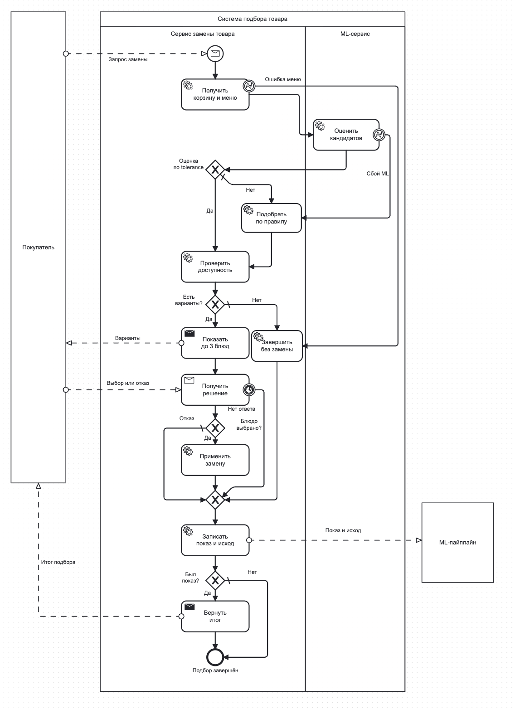
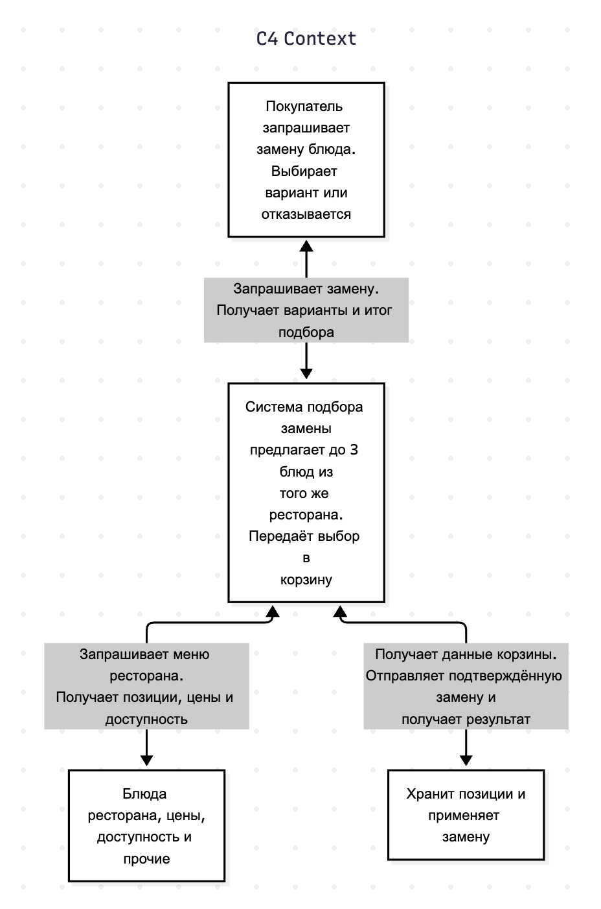
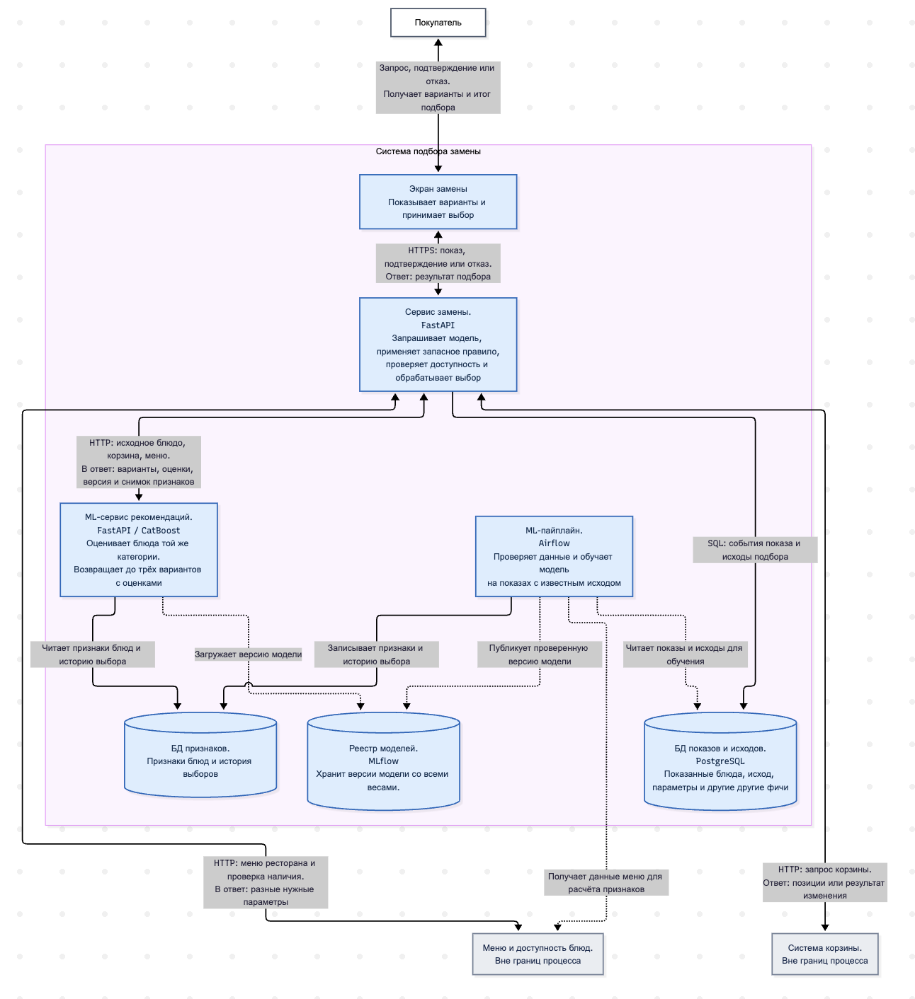
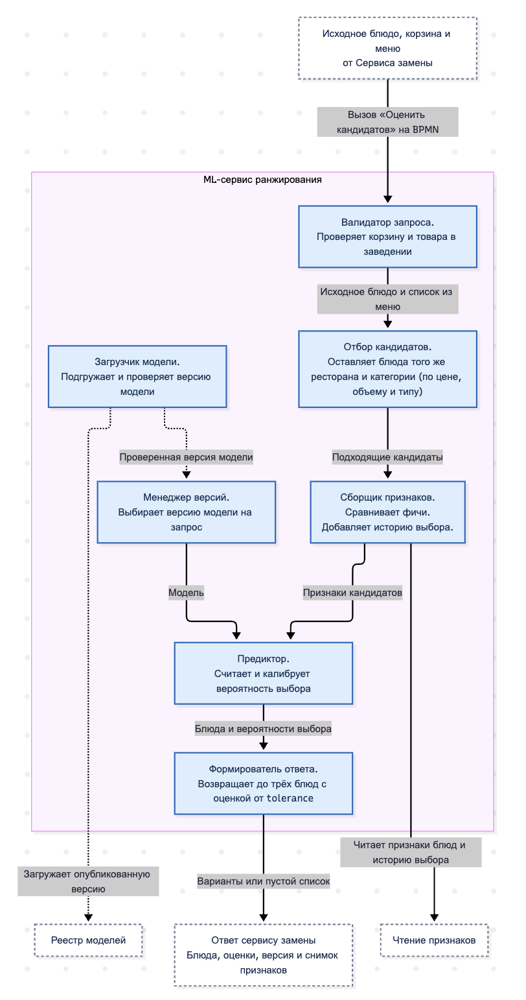

# Домашнее задание 6

## Процесс

### Сервис

Выбрал сервис "Яндекс Еда". Будем рассматривать процесс - блюдо в корзине стало недоступно. Если блюдо в корзине стало недоступно до/при оформления заказа, покупатель может попросить подобрать замену (какой-то попапчик условно). Приложение показывает подходящие блюда из меню того же ресторана. Покупатель выбирает одно из них и подтверждает замену в корзине. Если подходящих вариантов нет, подбор завершается без показа предложений и без изменения корзины. Здесь решил не расширять функционал предложения товаров из других ресторанов.

### Что делает модель

Модель получает содержимое корзины и список доступных блюд того же ресторана (откуда мы знаем недостающие блюдо). Она учитывает категорию, цену, историю выбора замен и другие возможные фичи. Для каждого блюда модель оценивает вероятность того, что покупатель его выберет.

Модель возвращает сервису замены до трёх вариантов с оценкой не ниже `tolerance`. Сервис перепроверяет доступность, затем показывает варианты покупателю. Для бизнеса важно сократить время поиска замены и увеличить количество проданного продукта.

Сведения об исходном блюде берём из корзины, варианты замены и их доступность из меню ресторана, а историю выбора из журнала событий.

### Допущения

Для ДЗ сделал предположения:

- Предполагаю, что из корзины можно узнать, какое блюдо стало недоступно, а из меню того же ресторана получить список блюд.
- Сервис ищет блюда той же категории (тут не сильно силен в рексисе, поэтому предполагаем, что есть какие-то фичи, по которым мы определяем схожесть товаров). Перед показом ещё раз проверяет доступность.
- Приложение показывает до трёх вариантов. Для модели задаю стартовый порог `tolerance`.
- Если модель не предложила подходящей замены, сервис подбирает похожие блюда по простому правилу, например по цене и размеру порции. Если вариантов нет, то пользователь ничего не увидит.
- Сохраняем, какие блюда показали покупателю и чем закончился подбор. Для следующего обучения используем показы с известным результатом, например успешную замену или явный отказ.

### Границы процесса

Рассматриваем замену одного блюда в корзине на другое блюдо из меню того же ресторана до оформления заказа. Оплата, предложение из другого заведения, доставка не рассматриваются.

## Схемы

Файл BPMN можно открыть в [редакторе bpmn.io](https://demo.bpmn.io/).

Файлы Mermaid можно открыть в [Mermaid Live](https://mermaid.live/), достаточно скопировать файлик и вставить в code (лучше юзайте светлую тему, иначе прям плохо будет)

### BPMN

- **Сплошная стрелка** показывает, какой шаг выполняется дальше.
- **Пунктирная стрелка** показывает передачу сообщения между участниками.

[Исходник 01-process.bpmn](diagrams/01-process.bpmn)

### C4 Context

Покупатель обращается к системе подбора, чтобы заменить блюдо в корзине. Система получает данные корзины и проверяет, какие блюда доступны в меню того же ресторана. Если покупатель выбирает один из предложенных вариантов, система передаёт его в корзину, которая применяет замену.

[Исходник 02-context.mmd](diagrams/02-context.mmd)

### C4 Containers

Экран замены показывает покупателю варианты и передаёт его решение сервису замены. Сервис получает данные корзины и меню, а ML-сервис оценивает блюда по признакам и истории выбора из отдельной базы. Показанные варианты и итог подбора сохраняются в БД показов и исходов. На этих данных ML-пайплайн переобучает модель (тут естесвтенно стоит регуляризовать процесс условно раз в день) и публикует версию в реестре, откуда её загружает ML-сервис.

[Исходник 03-containers.mmd](diagrams/03-containers.mmd)

- **Белый блок** обозначает покупателя, **серые блоки** - внешние системы меню и корзины.
- **Светло-фиолетовая область** показывает границу системы подбора. Внутри неё **синие прямоугольники** обозначают экран, сервисы и ML-пайплайн, а **синие цилиндры** - базы данных и реестр моделей.
- **Сплошные стрелки** показывают запросы при подборе замены, запись результата и запись признаков в БД.
- **Пунктирные стрелки** показывают чтение данных для обучения, публикацию и загрузку версии модели.

### C4 Components

ML-сервис проверяет входные данные, отбирает подходящие блюда из меню того же ресторана и собирает их признаки. Предиктор оценивает вероятность выбора каждого блюда с помощью модели, которую выбрал менеджер версий. Формирователь ответа возвращает сервису замены до трёх блюд, прошедших порог, или пустой список.

[Исходник 04-ml-components.mmd](diagrams/04-ml-components.mmd)

- **Светло-фиолетовая область** показывает границу ML-сервиса ранжирования. **Голубые блоки** внутри неё обозначают его компоненты.
- **Белые блоки с пунктирной рамкой** обозначают входные данные, ответ сервису замены и точки обращения к реестру моделей и БД признаков.
- **Сплошные стрелки** показывают обработку запроса, чтение признаков и возврат ответа.
- **Пунктирные стрелки** показывают, как загрузчик обращается к реестру и передаёт проверенную модель менеджеру версий.

## Соответствие BPMN и C4

| Шаг BPMN | Что ему соответствует в C4 |
|---|---|
| «Запрос замены» | Покупатель отправляет запрос через экран замены, а экран передаёт его сервису замены. |
| «Получить корзину и меню» | Сервис замены запрашивает позиции в системе корзины и меню того же ресторана. |
| «Оценить кандидатов» | Сервис замены вызывает контейнер **«ML-сервис рекомендаций»**. На C4 Components показано, как внутри него сборщик читает БД признаков, предиктор оценивает вероятность выбора, а формирователь ответа возвращает сервису замены варианты с оценками или пустой список. |
| «Оценка по tolerance» и «Подобрать по правилу» | Сервис замены использует ответ ML, если он корректен и максимальная оценка не ниже `tolerance`. При сбое ML или если условие не выполняется, сервис подбирает блюда по простому правилу. |
| «Проверить доступность», «Есть варианты?» и «Показать до 3 блюд» | Сервис замены повторно проверяет доступность по меню. Если варианты остались, экран показывает покупателю до трёх блюд. |
| «Завершить без замены» | При ошибке получения меню или если после проверки доступности вариантов нет, сервис завершает подбор без изменения корзины. |
| «Получить решение», «Блюдо выбрано?» и «Применить замену» | Экран передаёт сервису выбор или отказ. При выборе сервис передаёт подтверждённую замену в систему корзины, которая её применяет. При отказе или отсутствии ответа корзина остаётся прежней. |
| «Записать показ и исход» | Сервис замены сохраняет в БД показов и исходов, были ли показаны варианты и чем завершился подбор. Сообщение «Показ и исход» на BPMN показывает обратную связь для обучения. На C4 Containers ML-пайплайн читает эти записи из БД и обучает модель на показах с известным исходом. |
| «Был показ?» и «Вернуть итог» | Сервис замены возвращает итог через экран, если покупателю показывали варианты. Без показа процесс завершается без сообщения покупателю. |

## Источники

Ниже перечислю то на что ссылался при работе, все остальное делал самостоятельно.

- Отбор кандидатов, признаки и ранжирование смотрел в презенташке по архетиктуру рекомендательных систем.
- Запасной путь при тайм-ауте и проверка наличия товара перед показом взял из презенташки архетиктуры посиковых систем.
- Для C4 Containers сверил, как показать сервисы и хранилища внутри границы системы и подписать их связи. [Container diagram](https://c4model.com/diagrams/container).
- Для построения BPMN основывался на примере [Camunda](https://camunda.com/bpmn/examples/#bpmn-examples-four-eyes-principle). На схеме подчеркнул как сделать обмен с покупателем и передачей исхода в ML-пайплайн.
